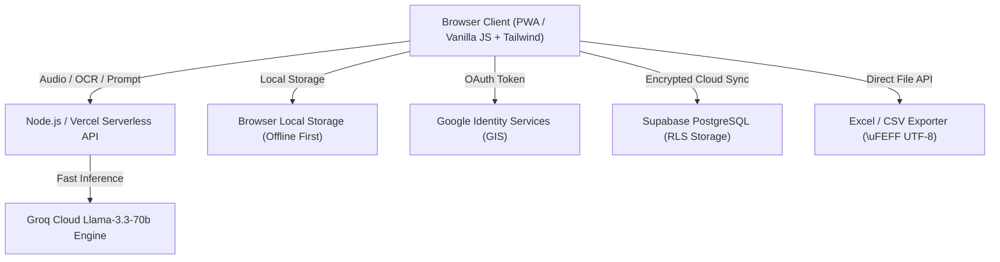

# 📄 Product Requirements Document (PRD)

**Product Name:** Smart Planner AI (Dayframe Pro)  
**Document Version:** 1.0.0  
**Status:** Approved / In Production  
**Live Application:** [https://smartplanner-pro.vercel.app](https://smartplanner-pro.vercel.app)  
**Repository:** [GitHub Repository](https://github.com/aaryanbhargava75/https-smartplanner-pro.vercel.app-)  
**Target Audience:** Knowledge Workers, Freelancers, Gen-Z Students, ADHD & Neurodivergent Planners  

---

## 1. Executive Summary & Vision

### 1.1 The Problem
Traditional productivity tools suffer from the **"Setup Tax" Paradox**:
- **Notion** presents a blank canvas requiring hours of database structuring and template curation.
- **Google Calendar** enforces rigid, multi-click modal forms (start time, end time, notification, title, color tag).
- **Todoist / TickTick** maintain infinite linear lists detached from temporal reality (24 hours in a day).
- **Cognitive Exhaustion:** By the time a user finishes manually scheduling their day, their cognitive energy to actually *execute* tasks is depleted.

### 1.2 The Product Vision
> *"Eliminate the friction of planning. Enable zero-tax organization where thoughts dumped via audio, camera receipt scans, or unstructured Hinglish text are instantly converted into an actionable, circadian 24-hour visual schedule with zero manual entry."*

### 1.3 Key Value Propositions
1. **Zero-Setup Multimodal Brain Dump:** Dictate a stream-of-consciousness voice note or upload a receipt photo; AI extracts tasks, time blocks, and financial expenses automatically.
2. **24-Hour Circadian Circular Dial:** Visualizes time as a continuous day-night cycle rather than a fragmented linear grid, solving time-blindness for ADHD and visual thinkers.
3. **Local-First, Cloud-Synced Privacy:** Zero tracking; data lives in client browser cache with optional Google OAuth + Supabase cloud sync.
4. **Frictionless Data Portability:** 1-click formatted Excel Spreadsheet (`.csv` UTF-8 BOM) export for universal compatibility.

---

## 2. User Personas & Core User Stories

| Persona | Demographics & Context | Primary Need | Dayframe AI Solution |
| :--- | :--- | :--- | :--- |
| **A: The Overwhelmed Student** | 19–24 yrs, College/Exam Aspirant | Chaos across WhatsApp groups, assignments, and UPI payments | Takes a photo of assignment notes -> AI auto-allocates study sprints. |
| **B: The High-Velocity Freelancer** | 24–34 yrs, Multiple client projects | Switching between Google Calendar, Splitwise, and Notes | Records 20-second voice memo while walking -> Schedules meetings & logs client billing. |
| **C: The ADHD / Visual Planner** | All ages, Executive dysfunction | Time-blindness; linear lists cause anxiety and abandonment | 24-Hour Circular Dial anchors tasks into morning/afternoon/night blocks visually. |

### Core User Stories:
* **US-01 (Voice Scheduling):** *As a busy professional, I want to record an unstructured 15-second voice note in Hindi or English so that my day is automatically scheduled without typing.*
* **US-02 (Visual Time Blocking):** *As a visual thinker, I want to see my entire 24-hour day in a single circular view so that I never double-book or suffer from time-blindness.*
* **US-03 (Instant Expense Extraction):** *As a freelancer, I want to paste or photograph receipts so that expenses are categorized and calculated automatically.*
* **US-04 (Excel Export):** *As a user, I want to export all my planner data, schedules, and expenses into Microsoft Excel with one click for tax or archival purposes.*

---

## 3. Functional Requirements (FR)

### FR-01: Multimodal Autonomous Brain Dump Engine
* **Input Modalities:**
  * **Audio Voice Notes:** Real-time speech recognition via Web Speech API and backend Whisper transcription.
  * **Image / Camera OCR:** Drag-and-drop or clipboard paste of receipts, handwritten notes, or schedule screenshots.
  * **Text Stream-of-Consciousness:** Raw paragraphs in English, Hindi, or Hinglish (e.g., *"Subah 10 baje client call hai, fir sham ko 500 rupay ki groceries li"*).
* **AI Parsing & Routing:**
  * High-speed LLM (Llama-3.3-70b via Groq Cloud API, `<800ms` latency).
  * Auto-extracts JSON schema containing: `tasks[]`, `schedule_blocks[]`, `expenses[]`, `incomes[]`, `milestones[]`.
  * Collision detection: Intelligently finds open slots in the schedule without overlapping existing high-priority blocks.

### FR-02: 24-Hour Circadian Circular Visual Dial
* **Visual Structure:**
  * Continuous 360-degree SVG circular dial representing 00:00 to 24:00.
  * Color-coded circadian sectors: Deep Night (00:00–06:00), Morning Focus (06:00–12:00), Afternoon Execution (12:00–18:00), Evening Wind-down (18:00–24:00).
* **Interactions:**
  * **Drag-to-Schedule:** Drag any task card from the backlog directly onto the dial angle to assign a time slot.
  * **Live Time Indicator:** Real-time sweep hand displaying current local hour and minute.
  * **Hover & Click:** Quick inspection of block duration, category, and notes.

### FR-03: Task & Backlog Management System
* **Priority Matrix:** Eisenhower-style priority tags (`high`, `medium`, `low`).
* **Category Tagging:** Work, Personal, Health, Finance, Learning.
* **Integrated Pomodoro Timer:**
  * Configurable 25-minute deep focus sprints with audio chimes.
  * Links active timer to the selected task to track cumulative focus minutes.

### FR-04: Financial Tracking & Net Worth Calculator
* **Expense & Income Logging:** Real-time balance, daily burn rate, and asset value computation.
* **Currency Flexibility:** Dynamic global currency switcher (`₹`, `$`, `€`, `£`, `¥`).
* **Category Auto-Tagging:** Food, Transport, SaaS, Bills, Investments, Shopping.

### FR-05: Not-To-Do List (Distraction Guardrails)
* Explicit anti-habit list (e.g., *"No phone scrolling before 10 AM focus block"*).
* Acts as a psychological commitment device displayed prominently alongside daily tasks.

### FR-06: Goal Milestones & Habits
* Long-term milestone tracking with target completion dates and percentage progress bars.
* Nested sub-checklists for granular execution steps.

### FR-07: Data Portability & Excel Spreadsheet Exporter
* **Primary Export Button:** One-click `.csv` file generation with Microsoft Excel UTF-8 Byte Order Mark (`\uFEFF`).
* **Structured Multi-Table Output:**
  1. *Section 1:* Tasks & Backlog
  2. *Section 2:* Daily Schedule & Time Blocks
  3. *Section 3:* Expenses & Financial Log
  4. *Section 4:* Incomes & Revenue
  5. *Section 5:* Assets & Net Worth
  6. *Section 6:* Goals & Milestones
  7. *Section 7:* Not-To-Do Habit Breakers
* **Developer JSON Backup:** Raw JSON export and import for seamless cross-device migration.

### FR-08: Authentication & Isolated Multi-Tenant Storage
* **Guest / Demo Mode:** Full offline functionality utilizing browser `localStorage`.
* **Google OAuth 2.0 (GIS):** One-tap login with Google.
* **Cloud Sync (Supabase PostgreSQL):** Row-Level Security (RLS) ensuring each user's data is isolated and encrypted.

---

## 4. Non-Functional Requirements (NFR)

* **Performance & Latency:**
  * Initial page load: `< 1.2s` on 4G networks.
  * AI Brain Dump inference: `< 1.5s` end-to-end response time.
* **Design & Aesthetics:**
  * Premium dark/light glassmorphic UI (`#111c24` / `#f5f7fa` palettes).
  * High-contrast accessibility adhering to WCAG 2.1 AA standards.
* **Offline First & PWA:**
  * Service worker (`sw.js`) caching assets for full offline operation.
  * Mobile and desktop install prompt via `manifest.json`.
* **Security & Privacy:**
  * Zero third-party telemetry or ad-tracking scripts.
  * Client-side sanitization preventing XSS and injection.

---

## 5. Technical Architecture & Tech Stack

* **Frontend:** Vanilla HTML5, Modern CSS3 (Glassmorphism & CSS Variables), Tailwind CSS CDN.
* **Backend:** Node.js Express server (`server.js`) deployed as a Vercel serverless application.
* **AI Engine:** Groq Cloud Llama-3.3-70b-versatile for sub-second structured JSON reasoning.
* **Database:** Supabase PostgreSQL with User-Scoped RLS tables.
* **Hosting:** Vercel Global Edge Network with CI/CD GitHub deployment.

---

## 6. Success Metrics & Key Performance Indicators (KPIs)

| Metric | Target | Measurement Method |
| :--- | :--- | :--- |
| **Time-to-First-Schedule** | `< 45 seconds` | Time from landing to first scheduled time block |
| **Brain Dump Conversion Rate** | `> 85%` | % of voice/text dumps accepted without manual edits |
| **7-Day User Retention (D7)** | `> 40%` | Active planner sessions 7 days post-onboarding |
| **Export Utility Frequency** | `> 15%` | Users utilizing the Excel spreadsheet export weekly |

---

## 7. Product Roadmap

* **Phase 1 (Current - Completed):**
  - [x] 24-Hour Circular SVG Time-blocking Dial.
  - [x] Multimodal Groq AI Brain Dump (Voice, OCR, Text).
  - [x] Google OAuth & Supabase Multi-Tenant Cloud Sync.
  - [x] Excel Spreadsheet (.csv) Full Multi-Table Exporter.
  - [x] Redesigned Glassmorphic Settings Modal.
* **Phase 2 (Next Sprint):**
  - [ ] Two-Way Google Calendar & Outlook Sync (iCal feed).
  - [ ] WhatsApp Bot Integration (Forward voice notes directly to schedule).
  - [ ] Gamified Focus Streaks & Weekly Productivity Analytics.
* **Phase 3 (Enterprise / Commercialization):**
  - [ ] Multi-User Team Calendar & Shared Workspaces.
  - [ ] Pro Tier Subscription ($8/month) via Stripe / Razorpay.
