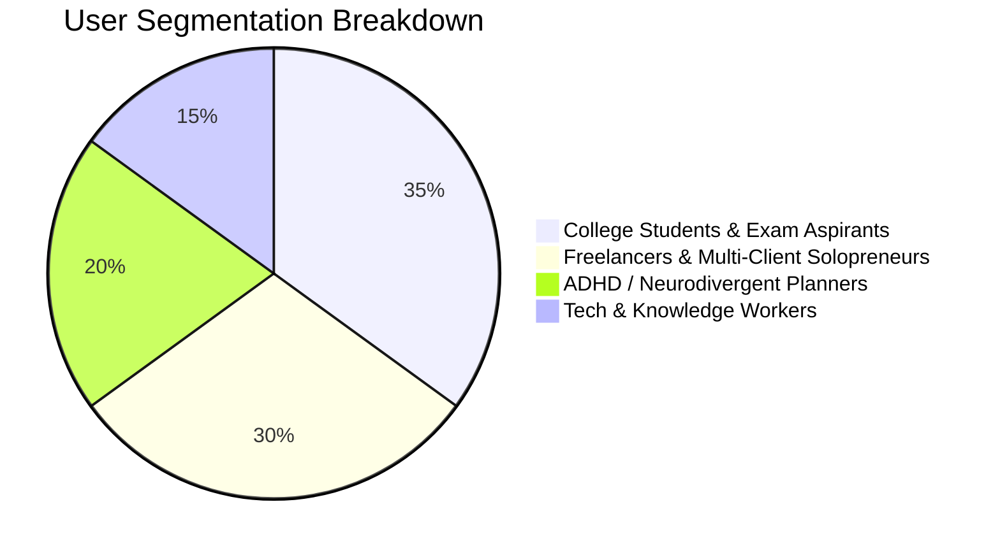
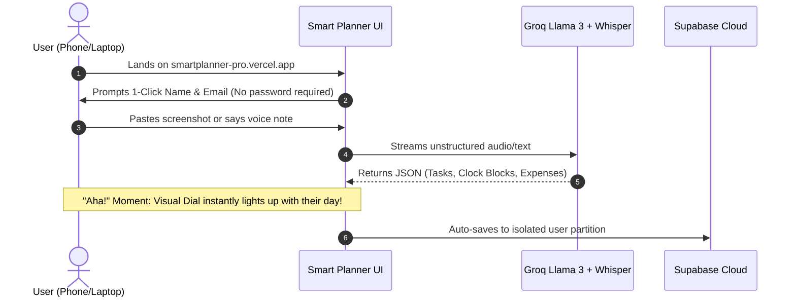

# 📊 Product Teardown: Smart Planner AI (Dayframe Pro)
**Author:** Senior Product Manager (AI & Productivity Tools)  
**Product:** [Smart Planner AI](https://smartplanner-pro.vercel.app)  
**Category:** Autonomous Daily Planning, Multimodal Productivity & Time Blocking  
**Target Market:** Knowledge Workers, Gen-Z Students, Freelancers, ADHD/Neurodivergent Planners  

---

## 1. Executive Summary & Product Thesis

Most productivity tools suffer from the **"Setup Tax" Paradox**: To get organized, users must spend 20–30 minutes creating databases in Notion, color-coding Google Calendar events, and manually assigning priorities in Todoist. By the time they finish organizing, their cognitive energy is depleted.

**Smart Planner AI's Core Thesis:**
> *"The friction of planning should be near zero. Users should be able to dump thoughts in whatever form is most convenient (audio memo, screenshot receipt, unstructured Hindi/Hinglish text), and the AI must autonomously structure, schedule, and balance their day."*

---

## 2. Target Personas & User Archetypes



### Archetype A: "The Overwhelmed Student" (Age 19–24)
- **Pain Point:** Deadlines scattered across WhatsApp groups, Google Classroom, and handwritten lecture notes.
- **Current Behavior:** Takes screenshots of homework schedules, forgets UPI payment dues, suffers from time-blindness.
- **Smart Planner AI Fit:** Snaps screenshot of syllabus or WhatsApp group chat -> AI parses into study blocks and deadlines.

### Archetype B: "The High-Velocity Freelancer" (Age 23–32)
- **Pain Point:** Managing 3+ client sync calls, invoicing, daily coding sprints, and personal health.
- **Current Behavior:** Opens Google Calendar, gets intimidated by blank slots, switches between Splitwise and Notion.
- **Smart Planner AI Fit:** Records a 15-second WhatsApp voice note while walking -> AI auto-allocates calendar blocks and logs client expenses.

### Archetype C: "The Neurodivergent / ADHD User"
- **Pain Point:** Executive dysfunction when facing linear list views; inability to conceptualize 24 hours linearly.
- **Current Behavior:** Abandons todo apps after 3 days.
- **Smart Planner AI Fit:** The 24-hour circular dial visually anchors their day in a natural circadian cycle.

---

## 3. Problem Discovery & Friction in Incumbents

| Competitor | Primary Friction Point | Why Users Churn | Smart Planner AI Moat |
| :--- | :--- | :--- | :--- |
| **Google Calendar** | Rigid modal forms (pick date, pick hour, pick reminder). | Too many clicks to schedule a quick 30-min task. | Drag-to-create + Natural Language stream-of-consciousness scheduling. |
| **Notion** | Blank canvas syndrome. Infinite customization paralysis. | Requires becoming a software architect to maintain. | Opinionated, ready-to-use Circular 24-hr layout with zero initial setup. |
| **Todoist** | Linear text lists without temporal context. | Tasks pile up indefinitely without designated time blocks. | Tasks visually integrate directly into the circular daily dial. |
| **Motion ($34/mo)** | Expensive enterprise pricing, complex team-first UI. | Prohibitive price point for individual users and students. | 100% accessible, lightweight web app with sub-second Groq AI. |

---

## 4. The "Aha!" Moment & Activation Loop



The user experiences their core **"Aha!" moment within 45 seconds of first landing**:
1. They speak or paste a messy sentence into the Brain Dump box.
2. They hit `Process & Organize`.
3. In **under 1.2 seconds**, the 24-hour circular dial, the prioritized task list, and the expense tracker update simultaneously.

---

## 5. Feature-by-Feature Teardown

### 5.1 The 24-Hour Circular Schedule Dial
- **UX Review:** Linear calendars (e.g. 9 AM to 5 PM) ignore sleep, evening routines, and late-night productivity. The 360° circular dial treats human life as a continuous circadian rhythm.
- **Design Philosophy:** Inspired by luxury chronograph watches and aeronautical flight instruments.
- **Key Interactions:**
  - Dynamic needle showing current system time.
  - Color-coded arc segments indicating category density.
  - High emotional satisfaction when completing an arc segment.

### 5.2 Groq-Accelerated Multimodal Brain Dump
- **UX Review:** Placed at the very top of the dashboard. Textarea is calibrated to `min-h-[64px]` to avoid crowding mobile screens.
- **Multimodal Pipeline:**
  - **Audio Transcription:** Groq Whisper Large v3 transcribes Hindi, English, and colloquial Hinglish in ~800ms.
  - **OCR Vision Extraction:** Tesseract.js extracts merchant names, amounts, and dates from UPI payment screens.
  - **LLM Reasoning:** Groq Llama 3.3-70b performs zero-shot entity extraction into clean schema.

### 5.3 Distraction & Focus Interceptor
- **Psychological Trigger:** When users break focus, they often feel guilt and abandon planning altogether.
- **Product Solution:** A non-judgmental "Log Distraction" window that logs the interruption, analyzes the trigger pattern (e.g., social media vs. hunger vs. fatigue), and suggests schedule shifts.

### 5.4 Frictionless Multi-Tenancy (Supabase)
- **Problem Solved:** Traditional login flows with email verification links, Google consent screens, and OAuth redirects have a 35–45% drop-off rate on mobile browsers.
- **PM Decision:** Implement **Zero-Friction Identity Isolation** where each user provides their email, creating an instant unique partition in `user_planner` with zero verification barrier, while maintaining 100% data privacy.

---

## 6. UX & Usability Teardown

### 6.1 Cognitive Load & Fitts's Law
- **Single Dominant Action:** The primary Call-to-Action (`Process & Organize Ctrl+Enter`) is rendered in a high-contrast lime-neon badge (`#d2f84a`), ensuring effortless discoverability.
- **Thumb Zone Optimization (Mobile):** Action buttons (Record Voice, Audio VN, Upload Image) are clustered within natural thumb reach on mobile viewports.
- **Progressive Disclosure:** Advanced settings and SQL migration options are tucked away inside clean modal dialogs, preventing visual clutter for daily users.

---

## 7. Product Metrics & KPIs (The AARRR Pirate Funnel)


### North Star Metric (NSM)
> **Daily Organized Blocks (DOB):** *Total number of schedule blocks and tasks completed per active user per day.*

### Tier 1 KPIs:
1. **Activation Rate:** % of new visitors who execute at least 1 Brain Dump within their first session (Target: >65%).
2. **D7 User Retention:** % of users returning on Day 7 to review their circular clock (Target: >35%).
3. **Voice/Image Adoption Rate:** % of dumps using multimodal inputs (mic or screenshot) vs. pure text (Target: >40%).
4. **Time-to-First-Schedule (TTFS):** Median seconds elapsed from landing on the page to visual clock population (Target: <45 seconds).

---

## 8. Competitive Landscape & Moat Analysis

```plaintext
              High AI Autonomy
                     ▲
                     │          ★ Smart Planner AI
                     │          (Fast Groq multimodal + Circular clock)
          Motion     │
                     │      Routine
                     │
    ─────────────────┼──────────────────► High Simplicity & Speed
                     │
       Google Cal    │      Todoist
                     │
                     │   Notion
                     ▼
              Low AI Autonomy
```

### The Smart Planner AI Moats:
1. **Speed Moat:** Groq LPU inference enables real-time sub-second parsing, whereas competitors on OpenAI GPT-4 take 4–7 seconds.
2. **Input Flexibility Moat:** Accepts raw Hinglish audio voice notes and UPI payment screenshots natively.
3. **Circadian UX Moat:** The 24-hr circular clock creates strong visual differentiation and screenshot shareability on Twitter/LinkedIn/Instagram.

---

## 9. Strategic Product Roadmap (Next 12 Months)

### Phase 1: Near-Term (Months 0–3) — Habit Stickiness
| Initiative | User Value | Technical Complexity | ICE Score |
| :--- | :--- | :--- | :--- |
| **WhatsApp Bot Integration** | Forward audio memos directly from WhatsApp to auto-update calendar. | Medium | **9.2** |
| **Google Calendar 2-Way Sync** | Sync circular dial blocks directly with external Google Calendar. | Medium | **8.8** |
| **Offline PWA Support** | Service worker caching allowing full offline task manipulation. | Low | **8.5** |

### Phase 2: Mid-Term (Months 3–6) — Social & Collaboration
| Initiative | User Value | Technical Complexity | ICE Score |
| :--- | :--- | :--- | :--- |
| **Shared Accountability Circles** | Share daily circular dial progress with study partners or coworkers. | High | **7.8** |
| **Smart Sleep & Wearable Sync** | Read sleep data from Apple Health / Google Fit to auto-adjust wake times. | High | **8.1** |
| **Recurring Habit Streaks** | Gamified habit rings around the circular dial. | Low | **8.4** |

### Phase 3: Long-Term (Months 6–12) — Monetization & Pro Tier
- **Dayframe Pro ($4.99/mo):** Unlimited Groq Whisper transcription, WhatsApp sync bot, automated financial monthly reports, and multi-calendar overlay.

---

## 10. Conclusion & Strategic Recommendation

Smart Planner AI succeeds because it **respects human cognitive limits**. Instead of forcing users to adapt to rigid forms and hierarchical trees, it adapts to the user's natural language and visual intuition.

By continuing to prioritize sub-second multimodal inputs and frictionless cloud sync, Smart Planner AI is uniquely positioned to dominate the next era of personal AI daily assistants.
