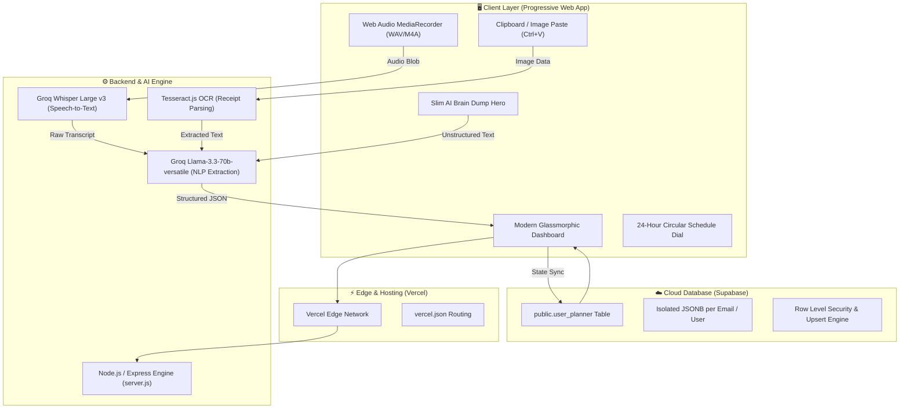

# 🧠 Smart Planner AI (Dayframe Pro)

> **Next-Generation Autonomous Daily Productivity, Circular Schedule Visualizer & Multimodal AI Brain Dump.**  
> Effortlessly turn chaotic thoughts, voice notes, and screenshot bills into structured schedules, tasks, and budgets with zero friction.

[](https://smartplanner-pro.vercel.app)
[](https://supabase.com)
[](https://groq.com)
[](https://vercel.com)

---

## 🌟 Executive Overview

**Smart Planner AI** bridges the massive cognitive gap between *unstructured human thought* and *structured time-management*. Traditional calendar and todo apps (Notion, Google Calendar, Todoist) require intense manual setup, rigid categorization, and tedious date-picking.

Smart Planner AI flips this paradigm:
1. **Multimodal Input**: Speak freely in Hindi/English/Hinglish, paste a UPI receipt screenshot, or dump stream-of-consciousness text.
2. **AI Categorization**: Groq-powered AI instantaneously extracts **Time Blocks**, **Tasks with priorities**, **Financial expenses/income**, and **Timers**.
3. **Circular 24-Hour Clock Visualizer**: Live SVG interactive dial representing your entire day at a glance.
4. **Isolated Cloud Multi-Tenancy**: Zero-setup private workspaces powered by Supabase Cloud.

---

## 🏛️ System Architecture



---

## 🚀 Key Feature Modules

### 1. 🕒 24-Hour Circular Schedule Visualizer
- **Visual Time Perception**: A circular dial representing the 24 hours of a day.
- **Color-Coded Segments**: Deep Work (Emerald), Meetings (Blue), Health/Gym (Amber), Personal/Rest (Purple).
- **Current Time Needle**: Pulsing real-time needle tracking exact time of day.
- **Drag & Resize**: Interactive schedule manipulation without numeric time picker forms.

### 2. 🧠 Multimodal AI Brain Dump
- **Text Stream-of-Consciousness**: Type messy sentences like *"10 to 12:30 coding, 2pm client sync, 450 zomato lunch, 1400 wifi due friday"*.
- **Voice Memos & Audio Upload**: Supports direct mic recording or WhatsApp voice note files (`.m4a`, `.opus`, `.ogg`, `.mp3`). Transcribed via **Groq Whisper Large v3** in sub-second speeds.
- **Screenshot OCR Scanner**: Press `Ctrl+V` to paste UPI receipts, Paytm bills, WhatsApp chat screenshots, or handwritten notes.
- **Deterministic AI Extraction**: Returns clean JSON categorizing into:
  - 📅 **Schedule Blocks** (Start, End, Label, Category)
  - 📋 **Checklist Tasks** (Title, Priority, Deadline)
  - 💰 **Financial Transactions** (Amount, Type, Tag)
  - ⏳ **Focus Timers** (Duration, Subject)

### 3. 💳 Automated Finance & Budget Tracker
- Real-time income and expense logging.
- Categorization across Groceries, Tech, Food, Utilities, Investments.
- Automated monthly burn rate and balance calculations.

### 4. 🎯 Distraction & Focus Interceptor
- Log distraction trigger windows with one click.
- Identify focus leaks and receive AI coaching to reclaim lost productivity hours.

### 5. 👥 Multi-Tenant Cloud Architecture (Supabase)
- **Instant Passwordless Access**: Users simply enter their Name & Email.
- **100% Data Isolation**: Each email maps to an isolated record in Supabase `user_planner`.
- **Cross-Device Sync**: Accessible from mobile browsers, tablets, and desktops simultaneously.

---

## 🛠️ Technology Stack

| Layer | Technologies Used |
| :--- | :--- |
| **Frontend** | HTML5, Modern CSS3 (Glassmorphism, CSS Custom Properties), Vanilla ES2024 JavaScript, TailwindCSS JIT, Material Symbols Icons |
| **Visualization** | SVG Dynamic Dial Engine, Canvas 2D |
| **AI Models** | Groq Whisper Large v3 (Voice), Groq Llama 3.3-70b-versatile (Extraction), Tesseract.js (OCR) |
| **Backend Runtime** | Node.js v20+, Express.js, Multer (Audio Multipart) |
| **Database** | Supabase Postgres (JSONB multi-tenant schema with unique email constraint) |
| **Deployment** | Vercel Serverless Platform (`vercel.json`) |

---

## 📦 Directory Structure

```plaintext
master-planner/
├── api/                       # Vercel serverless functions
├── public/                    # Static assets & icons
├── user_databases/            # Local fallback user stores
├── index.html                 # Production root web app
├── smart-planner-ai.html      # Master development UI & logic
├── server.js                  # Express backend & AI proxy
├── upload-to-supabase.js      # Supabase migration & backup tool
├── vercel.json                # Vercel routing configuration
├── package.json               # Dependencies & scripts
├── sitemap.xml                # SEO Sitemap for Google Search Index
├── robots.txt                 # Search bot indexing directives
├── PRODUCT_TEARDOWN.md        # Senior PM Product Teardown & Strategy
└── README.md                  # System Documentation
```

---

## 💻 Local Development Setup

### 1. Prerequisites
- Node.js 18.x or higher
- npm 9.x or higher

### 2. Installation
```bash
# Clone the repository
git clone https://github.com/aaryanbhargava/smart-planner-ai.git
cd smart-planner-ai

# Install dependencies
npm install
```

### 3. Environment Variables
Create a `.env` file in the project root:
```env
PORT=3000
GROQ_API_KEY=your_groq_api_key_here
SUPABASE_URL=https://your-project.supabase.co
SUPABASE_ANON_KEY=your_supabase_anon_key_here
```

### 4. Run Locally
```bash
npm start
# Open http://localhost:3000 in your browser
```

---

## 🌐 Production Deployment

The project is preconfigured for zero-config deployment on Vercel:
```bash
npx vercel deploy --prod
```
Live URL: **[https://smartplanner-pro.vercel.app](https://smartplanner-pro.vercel.app)**

---

## 📄 License
MIT License. Built for seamless personal productivity and high-performance daily organization.
