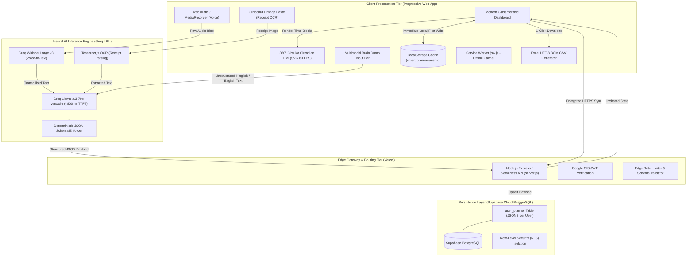
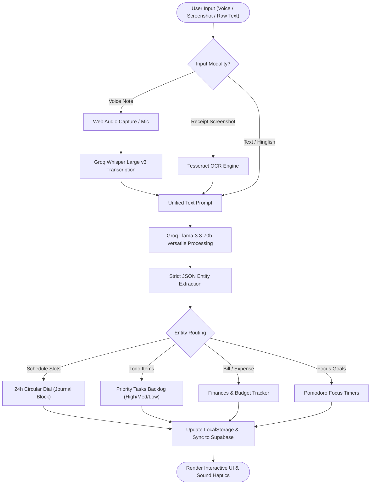
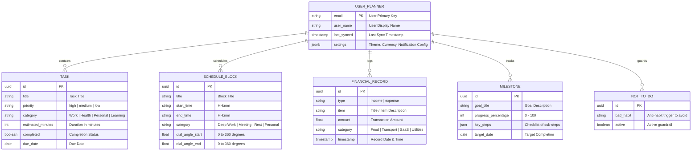

# 🏛️ Architecture: Smart Planner AI (Dayframe Pro)

## 1. System Overview & Core Philosophy

Smart Planner AI is engineered as a **Local-First, Edge-Assisted hybrid architecture**. 

### Architectural Tenets:
1. **Zero-Latency Client Execution:** The UI executes entirely within the browser DOM using Vanilla HTML5/ES6 and Dynamic SVG canvas rendering at 60 FPS.
2. **Local-First Privacy:** All tasks, journal blocks, financial logs, and settings are written immediately to browser `localStorage` (`smart-planner-user-{id}`) before any network call is initiated.
3. **Sub-Second Edge AI Inference:** Heavy AI workloads (Whisper speech-to-text, Tesseract image OCR, and Llama 3.3 entity categorization) run on high-performance edge compute (Vercel Serverless + Groq LPU LPUs) with sub-800ms Time-To-First-Token (TTFT).
4. **Isolated Multi-Tenant Cloud Sync:** User states are securely synchronized to Supabase Cloud PostgreSQL, partitioned strictly via Row-Level Security (RLS) policies.

---

## 2. High-Level System Architecture Diagram

---

## 3. Multimodal AI Processing Pipeline Flow

---

## 4. Database Schema & Entity Relational Design (ERD)

---

## 5. Architectural Layers Breakdown

### Layer 1: Client Presentation Tier (PWA)
- **Tech Stack:** Vanilla ES2024 JavaScript, HTML5, Modern CSS3 with CSS Custom Properties, Material Symbols.
- **24-Hour Circular Dial Canvas:** Real-time 360° SVG dial calculating trigonometric angles (`angle = (hours * 15) + (minutes * 0.25)`).
- **Service Worker (`sw.js`):** Intercepts network requests and caches core app assets for full offline functionality.
- **Local Storage Engine:** Isolates user states with key prefix `smart-planner-user-{email/id}`.

### Layer 2: Edge Gateway & Serverless API
- **Tech Stack:** Node.js v20+, Express.js, Vercel Serverless Functions (`server.js`, `api/`).
- **Secret Isolation:** Securely manages Groq API keys, Supabase Service Role keys, and OAuth client credentials without exposing secrets to client browsers.
- **Middleware:** CORS protection, rate limiting, and multipart audio parsing via Multer.

### Layer 3: Neural AI Inference Tier
- **Speech-to-Text:** Groq Whisper Large v3 transcribing multi-lingual audio in sub-second latency.
- **OCR Engine:** Tesseract.js / Base64 vision parsing UPI transaction IDs, merchant names, and monetary values.
- **NLP Categorization:** Groq Llama-3.3-70b-versatile steered with strict JSON Schema prompt engineering to prevent date/currency hallucinations.

### Layer 4: Multi-Tenant Cloud Persistence Tier
- **Tech Stack:** Supabase Cloud PostgreSQL with JSONB columns.
- **Row-Level Security (RLS):** Enforces data boundaries (`auth.uid() = user_id`), ensuring zero data cross-contamination between users.

---

## 6. Technical Performance & Security SLAs

| SLA Attribute | Target Benchmark | Architectural Guarantee |
| :--- | :--- | :--- |
| **Inference Latency** | `< 800 ms` | Groq Cloud LPU inference streaming |
| **Offline Readiness** | `100% Core Functionality` | Local-First LocalStorage + Service Worker |
| **Data Privacy** | `Zero Third-Party Trackers` | No Google Analytics, no Facebook Pixels, no telemetry |
| **Export Integrity** | `100% Excel Compatible` | UTF-8 Byte Order Mark (`\uFEFF`) CSV stream |
| **Dial Frame Rate** | `60 FPS` | SVG dynamic angle transforms with hardware acceleration |
