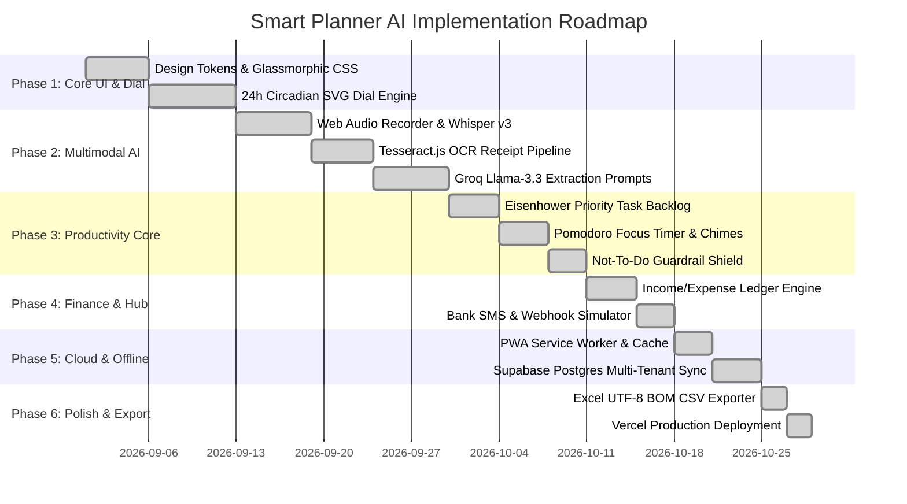

# 📋 Implementation Plan: Smart Planner AI (Dayframe Pro)

## 1. Project Overview & Delivery Strategy

The implementation of Smart Planner AI follows a modular, local-first engineering strategy. Development is structured across six systematic phases, ensuring each subsystem is fully testable and functional offline before connecting to cloud AI and database services.

---

## 2. Phase-by-Phase Roadmap

---

## 3. Detailed Phase Breakdown

### Phase 1: Core Shell, Design Tokens & 24h Circular Dial Engine
* **Objective:** Establish the visual foundation and interactive circular dial.
* **Key Tasks:**
  1. Define CSS custom properties for circadian day/night sectors (Deep Night, Morning Focus, Afternoon Execution, Evening Rest).
  2. Implement SVG math: map 24-hour timestamps to 360° circular polar coordinates (`x = cx + r * cos(theta)`, `y = cy + r * sin(theta)`).
  3. Build the live real-time pulsing sweep hand updated via `setInterval` every 60 seconds.
  4. Enable click-and-drag schedule block resizing directly on the circular arc.
* **Acceptance Criteria:** Dial renders at smooth 60 FPS without layout shift or dropped frames.

### Phase 2: Multimodal AI Brain Dump Pipeline
* **Objective:** Enable effortless capture via Voice, Screenshots, and raw text.
* **Key Tasks:**
  1. Integrate `MediaRecorder` API for voice recording with fallback to WhatsApp audio file upload (`.m4a`, `.opus`, `.wav`).
  2. Connect **Groq Whisper Large v3** edge endpoint (`POST /api/ai/brain-dump`) for sub-second speech-to-text.
  3. Implement clipboard paste event (`Ctrl+V`) capturing raw images and extracting text via **Tesseract.js** OCR.
  4. Build strict JSON Schema prompt steering for **Groq Llama-3.3-70b-versatile** to categorize items into `tasks[]`, `schedule_blocks[]`, and `expenses[]`.
* **Acceptance Criteria:** Brain dump processing latency under 800ms; zero hallucinated dates or malformed JSON payloads.

### Phase 3: Task Backlog, Pomodoro Engine & Not-To-Do Shield
* **Objective:** Link planned tasks directly to execution tools.
* **Key Tasks:**
  1. Implement Eisenhower priority tags (`high`, `medium`, `low`) with duration badges.
  2. Build configurable 25-minute Pomodoro timer linked to the active task, logging cumulative deep focus minutes.
  3. Create the "Not-To-Do List" anti-habit guardrail to prevent distraction trigger windows.
* **Acceptance Criteria:** One-click transition from backlog task to active focus sprint with audio completion chimes.

### Phase 4: Financial Tracker & India SMS Hub
* **Objective:** Combine personal budgeting and daily spending into the same view.
* **Key Tasks:**
  1. Real-time balance, daily cash burn rate, and net worth asset calculator.
  2. Dynamic global currency switcher (`₹`, `$`, `€`, `£`, `¥`).
  3. Webhook receiver and simulator for Indian bank SMS formats (HDFC, SBI, ICICI, Paytm).
* **Acceptance Criteria:** Instant transaction logging without page reloads; accurate net worth summing.

### Phase 5: Local-First Storage, Service Worker & Cloud Sync
* **Objective:** Guarantee 100% offline functionality with seamless cloud sync.
* **Key Tasks:**
  1. Implement client-side repository pattern reading and writing synchronously to `localStorage`.
  2. Configure `sw.js` (Service Worker) to cache all static scripts, stylesheets, and icons for offline PWA installation.
  3. Implement `POST /api/sync/supabase` to upsert user state into Supabase `user_planner` table with Row-Level Security.
* **Acceptance Criteria:** App works completely offline in airplane mode; syncs immediately upon reconnecting to network.

### Phase 6: Universal Data Portability & Excel Exporter
* **Objective:** Ensure users own their data with zero platform lock-in.
* **Key Tasks:**
  1. Build client-side CSV generator injecting UTF-8 Byte Order Mark (`\uFEFF`) to prevent corrupt rupee symbols (`₹`) or character encoding errors in Microsoft Excel.
  2. Implement multi-section structured spreadsheet formatting (Tasks, Schedule Blocks, Expenses, Incomes, Net Worth, Milestones).
  3. Provide raw JSON backup export and import for developer migrations.
* **Acceptance Criteria:** CSV opens cleanly in Microsoft Excel, Google Sheets, and Apple Numbers without garbled text or broken columns.
